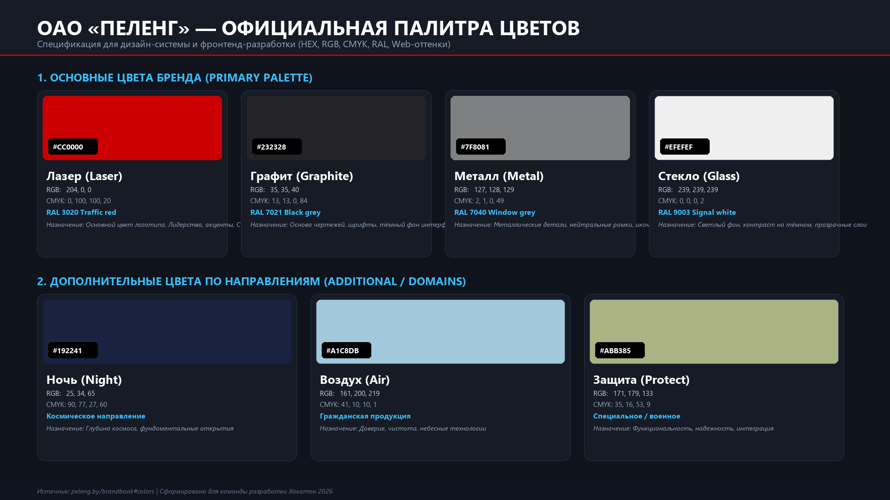

# ОАО «Пеленг» — Брендбук: Цвета, Типографика и ТЗ для разработки

Данный документ содержит официальные спецификации визуального стиля компании **ОАО «Пеленг»** ([peleng.by/brandbook#colors](https://peleng.by/brandbook#colors)) и техническое задание (ТЗ) для фронтенд- и UI-разработчиков команды.



---

## 1. Основные цвета бренда (Primary Palette)

Основные цвета обладают высокой контрастностью и идеальной сочетаемостью. Используются для формирования базового интерфейса, компонентов и фирменного стиля.

| Цвет | Превью | HEX | RGB | CMYK | RAL | Назначение в интерфейсе |
| :--- | :---: | :---: | :---: | :---: | :---: | :--- |
| **Лазер (Laser)** | <span style="background:#CC0000;display:inline-block;width:24px;height:24px;border-radius:4px;border:1px solid #999;"></span> | `#CC0000` | `204, 0, 0` | `0, 100, 100, 20` | `RAL 3020 Traffic red` | **Основной цвет логотипа и главный акцент**. Кнопки действий (Primary CTA), индикаторы лидерства, ключевые акцентные бейджи. |
| **Графит (Graphite)** | <span style="background:#232328;display:inline-block;width:24px;height:24px;border-radius:4px;border:1px solid #999;"></span> | `#232328` | `35, 35, 40` | `13, 13, 0, 84` | `RAL 7021 Black grey` | **Основа чертежей, шрифты и тёмные поверхности**. Тёмная тема интерфейса, карточки, подложки, контрастный текст. |
| **Металл (Metal)** | <span style="background:#7F8081;display:inline-block;width:24px;height:24px;border-radius:4px;border:1px solid #999;"></span> | `#7F8081` | `127, 128, 129` | `2, 1, 0, 49` | `RAL 7040 Window grey` | **Металлические детали и структуры**. Нейтральные разделители, рамки карточек, неактивные иконки, вторичный текст. |
| **Стекло (Glass)** | <span style="background:#EFEFEF;display:inline-block;width:24px;height:24px;border-radius:4px;border:1px solid #999;"></span> | `#EFEFEF` | `239, 239, 239` | `0, 0, 0, 2` | `RAL 9003 Signal white` | **Контраст на тёмном фоне и прозрачность**. Фоновые карточки в светлой теме, эффект матового стекла (glassmorphism), основной светлый текст на тёмном фоне. |

### Веб-оттенки основных цветов (Web Tones):
* **Лазер:** `#FFFFFF 25%` (светлый тинт), `#000000 30%` (тёмный тинт), `#000000 65%` (глубокий бордо).
* **Графит:** `#FFFFFF 20%` (поверхность карточки), `#000000 45%` (глубокий фон).
* **Металл:** `#FFFFFF 35%` (светлая рамка), `#000000 15%` (тень).
* **Стекло:** `#000000 5%` (подложка), `#FFFFFF 65%` (полупрозрачный оверлей).

---

## 2. Дополнительные цвета по направлениям (Domain Palette)

> [!IMPORTANT]
> **Правило брендбука:** Дополнительные цвета **не могут заменять основные**. Они не используются на флагах, корпоративной одежде и общей корпоративной продукции. Они строго привязаны к продуктовым направлениям.

| Направление | Цвет | Превью | HEX | RGB | CMYK | Смысловое значение |
| :--- | :--- | :---: | :---: | :---: | :---: | :--- |
| **Космическое направление** | **Ночь (Night)** | <span style="background:#192241;display:inline-block;width:24px;height:24px;border-radius:4px;border:1px solid #999;"></span> | `#192241` | `25, 34, 65` | `90, 77, 27, 60` | Воплощение бесконечности и фундаментальных открытий. Применяется для приборов космической отрасли. |
| **Гражданская продукция** | **Воздух (Air)** | <span style="background:#A1C8DB;display:inline-block;width:24px;height:24px;border-radius:4px;border:1px solid #999;"></span> | `#A1C8DB` | `161, 200, 219` | `41, 10, 10, 1` | Доверие, чистота, ясность. Ассоциируется с небом и надежной средой жизни. |
| **Специальное / военное** | **Защита (Protect)** | <span style="background:#ABB385;display:inline-block;width:24px;height:24px;border-radius:4px;border:1px solid #999;"></span> | `#ABB385` | `171, 179, 133` | `35, 16, 53, 9` | Функциональность, надежность, интеграция в экстремальных условиях. |

---

## 3. Типографика компании (Typography)

* **Заголовки и плакатный стиль:** `Bebas Neue` (гротеск, заглавные буквы, уверенный инженерный стиль).
* **Основной текст и интерфейсы:** `Roboto Condensed` (высокая информационная плотность, читаемость чертежей и табличных данных).
* **Системные веб-фолбэки:** `system-ui, -apple-system, "Segoe UI", Roboto, sans-serif`.

---

## 4. Готовые токены для фронтенд-разработки (CSS / Tailwind)

### CSS Variables (`variables.css`)
```css
:root {
  /* Основные цвета (Primary) */
  --peleng-laser: #CC0000;
  --peleng-graphite: #232328;
  --peleng-metal: #7F8081;
  --peleng-glass: #EFEFEF;

  /* Дополнительные цвета по направлениям */
  --peleng-night: #192241;    /* Космос */
  --peleng-air: #A1C8DB;      /* Гражданское */
  --peleng-protect: #ABB385;  /* Спецтехника */

  /* Семантические токены интерфейса */
  --color-bg-app: var(--peleng-graphite);
  --color-bg-card: rgba(255, 255, 255, 0.05);
  --color-border: rgba(127, 128, 129, 0.35);
  --color-accent: var(--peleng-laser);
  --color-text-primary: var(--peleng-glass);
  --color-text-secondary: var(--peleng-metal);

  /* Шрифты */
  --font-display: "Bebas Neue", sans-serif;
  --font-body: "Roboto Condensed", sans-serif;
}
```

### Tailwind CSS (`tailwind.config.js`)
```javascript
module.exports = {
  theme: {
    extend: {
      colors: {
        peleng: {
          laser: '#CC0000',
          graphite: '#232328',
          metal: '#7F8081',
          glass: '#EFEFEF',
          night: '#192241',
          air: '#A1C8DB',
          protect: '#ABB385',
        }
      },
      fontFamily: {
        display: ['Bebas Neue', 'sans-serif'],
        body: ['Roboto Condensed', 'sans-serif'],
      }
    }
  }
}
```

---

## 5. Правила использования (Do's & Don'ts)

*  **ДА:** Использовать «Лазер» (`#CC0000`) только как акцентный цвет и цвет логотипа.
*  **ДА:** Использовать «Графит» (`#232328`) как главный тёмный фон для демонстрации точности, оптики и инженерных чертежей.
*  **ДА:** Применять цвета направлений («Ночь», «Воздух», «Защита») в интерфейсах соответствующих модулей и приборов.
* ❌ **НЕТ:** Нельзя красить большие сплошные поверхности в цвет «Лазер» (это перегружает зрительное восприятие).
* ❌ **НЕТ:** Нельзя смешивать цвета направлений (например, использовать «Защиту» в космическом модуле).
* ❌ **НЕТ:** Нельзя заменять цвет логотипа на цвета дополнительных направлений.
